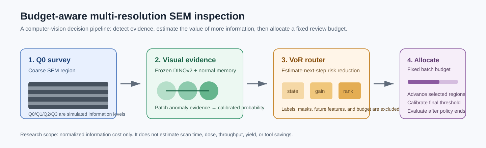
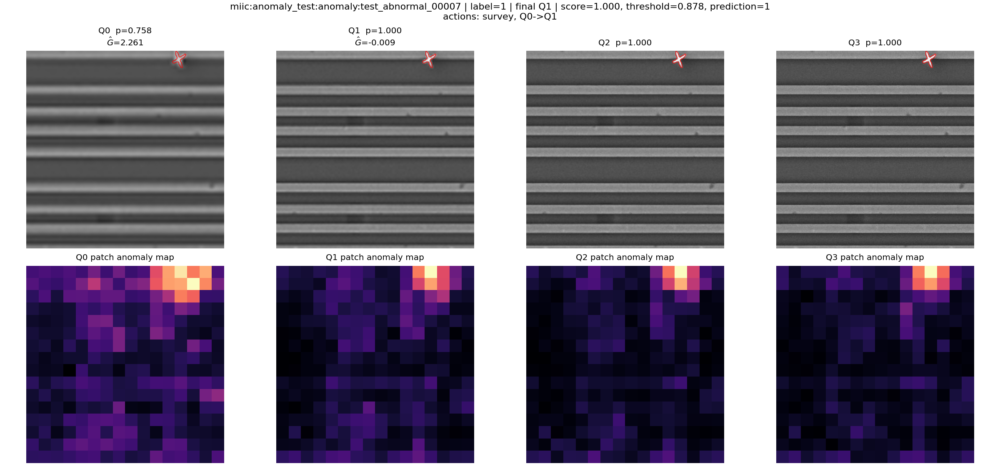
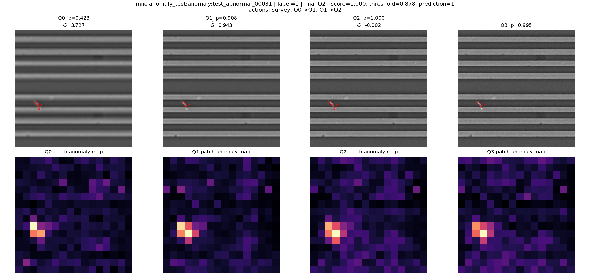
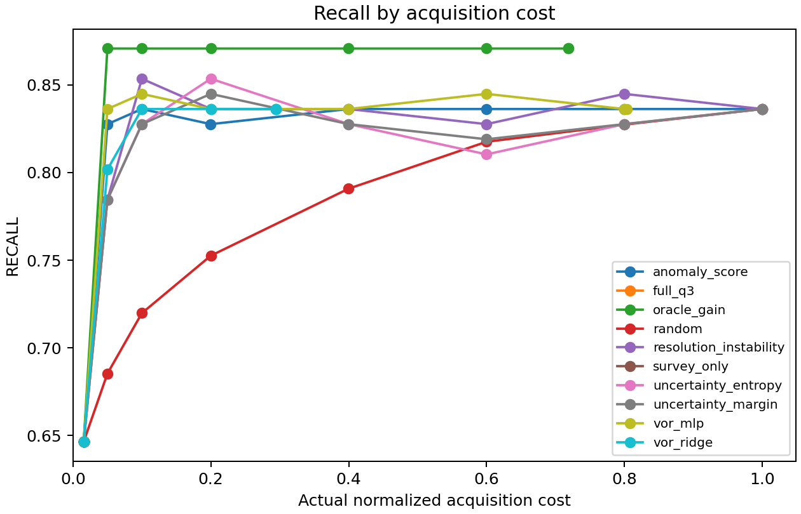

# Adaptive SEM Inspection

**Can a vision system decide which SEM regions deserve a more informative look
when the review budget is limited?**

This repository is a reproducible computer-vision study for **offline,
simulated multi-resolution SEM inspection**. It combines a frozen visual
encoder, normal-memory anomaly detection, calibrated decision thresholds, and
a learned *Value of Resolution* (VoR) router. The router is asked a narrow
question at each step: *will observing this region at the next quality level
reduce decision risk enough to justify its information cost?*

The framing should feel familiar to a semiconductor inspection or process
control engineer: not every candidate can receive the same expensive level of
review, and a useful system must balance sensitivity, review capacity, and
false-positive control. This is research code, however—not a tool controller,
fab integration, or throughput/yield model.



## Why this is more than an anomaly-detection demo

Most anomaly detectors answer one question once: *does this image look
unusual?* That is useful, but an inspection workflow also needs a decision
about **where to spend the next unit of information**. This project separates
those two jobs:

1. A frozen DINOv2 encoder compares SEM patches with a memory bank of normal
   patches and produces a calibrated anomaly probability.
2. A 53-feature router uses the current evidence, image quality, and past
   observations to estimate the value of taking the next-quality observation.
3. A deterministic budget allocator chooses which regions advance through
   Q0–Q3 without seeing labels, masks, or future features.
4. Final scores are evaluated only after the policy finishes, with thresholds
   calibrated on a held-out calibration lot.

That split is deliberate. It makes it possible to ask whether a smarter
review-allocation policy adds value beyond a strong, well-calibrated
uncertainty baseline.

## What the images look like

The examples below are real MIIC final-test regions rendered by the completed
failure-analysis pipeline. Each column is one simulated observation quality;
the red outline is the ground-truth anomaly mask, shown **only after the
policy decision**. The lower row is the detector's patch-level evidence. These
two cases are useful because moving from the coarse survey view to Q1/Q2
changes the decision correctly.

| Q0 → Q1 corrected case | Q0 → Q2 corrected case |
| --- | --- |
|  |  |

The code is MIT-licensed. The two illustrative MIIC-derived figures remain
subject to the source dataset's CC BY-NC 4.0 terms; see
[the asset notice](docs/assets/miic_examples/DATA_ASSET_NOTICE.md). No raw
dataset archives are included.

## The completed locked benchmark

The repository includes the non-sensitive output snapshot from the completed
sealed run under [`results/`](results/). The important result is intentionally
reported without spin:

| Fixed pixel-information budget | Recall | False-positive rate | Interpretation |
| --- | ---: | ---: | --- |
| Survey only | 64.66% | 0.79% | Coarse observation leaves recoverable misses. |
| Cost-normalized uncertainty | **85.34%** | **0.71%** | Strong simple allocation baseline. |
| Learned VoR MLP | 83.62% | 0.86% | Did not improve the locked primary comparison. |
| Oracle gain (diagnostic only) | 87.07% | 1.18% | Shows some remaining opportunity, but uses privileged information and is not deployable. |

At the predeclared 0.20 cost cap, VoR minus uncertainty recall was **−1.72
percentage points** with paired 95% CI **[−5.17, +0.88]**. The interval crosses
zero, so the sealed final test does **not** establish that the learned router
outperforms the uncertainty baseline. This is a useful outcome: the detector
and multi-resolution setup expose a real inspection decision, while the
synthetic-pair router target did not transfer cleanly enough to real MIIC
anomalies.



The detailed report, exact endpoint, immutable lock snapshot, metrics table,
and additional figures are in [results](results/README.md). The cost is an
information-cost abstraction—not SEM scan time, electron dose, wafer
throughput, yield, or commercial-tool savings.

## Native GPU quick start

The supported path is Linux with an NVIDIA GPU, a current driver, CUDA-enabled
PyTorch, Python 3.11 or 3.12, and `7z` for MIIC's RAR archives. The full setup
is in [docs/native_gpu.md](docs/native_gpu.md).

```bash
git clone <your-fork-url> adaptive-sem-inspection
cd adaptive-sem-inspection

python3.12 -m venv .venv
source .venv/bin/activate
python -m pip install --upgrade pip
python -m pip install -r requirements/gpu-cu126.lock
python -m pip install -e .

python scripts/verify_environment.py --require-gpu
python scripts/run_native_pipeline.py \
  --stage development \
  --runtime-root /fast-ssd/adaptive-sem-runtime \
  --accept-miic-license
```

MIIC is not bundled and its official host can be unreliable for long
downloads. After reading and accepting its license, you can download the five
official files in a browser and pass their directory through
`--miic-manual-bundle /path/to/MIIC_verified_files`; the pipeline checks the
published file sizes and MD5 hashes before it extracts anything.

When development is complete, create a source commit and run the sealed final
stage. Only then run post-lock exploratory analyses:

```bash
git add -A && git commit -m "Lock native experiment source"
python scripts/run_native_pipeline.py --stage final --runtime-root /fast-ssd/adaptive-sem-runtime
python scripts/run_native_pipeline.py --stage postlock --runtime-root /fast-ssd/adaptive-sem-runtime
```

The launcher is resumable. Re-running the same stage uses completed command
checkpoints from `runtime/artifacts/pipeline_state.json` rather than starting
over. Use `--stage status` to inspect progress.

## Repository map

```text
configs/       Frozen experiment, detector, router, simulator, and cost settings
src/           Reusable detector, router, policy, data, simulator, and evaluation code
scripts/       Resumable native-GPU launcher and individual reproducible stages
tests/         Contract and unit tests for data, policies, features, and locking
results/       Sealed-run snapshot: report, lock, endpoint, metrics, and figures
docs/          Native setup, architecture, data/model/protocol cards, engineering context
data/          Empty by design; downloaded data and runtime outputs stay outside Git
```

## Evaluation discipline

- The final MIIC test is sealed by a hash-checked lock. Changing the code,
  data manifest, model, configuration, or test IDs requires a new protocol
  version.
- Exact decoded-pixel duplicates between MIIC train/test archives are removed
  before split construction. Near-duplicate heuristics are not used to merge
  repetitive SEM textures.
- The router never receives class labels, masks, future observations,
  acquisition cost, or remaining global budget. The allocator handles the
  fixed budget separately.
- Stress, ablation, defect-size, prevalence, and Carinthia-S results are
  post-lock exploratory analyses. They must not replace the primary result.

## Read next

- [Native GPU setup and runbook](docs/native_gpu.md)
- [Architecture and design choices](docs/architecture.md)
- [Engineering context and limits](docs/engineering_context.md)
- [Result interpretation](docs/results.md)
- [Data card](docs/data_card.md), [model/policy card](docs/model_card.md), and
  [protocol contract](docs/protocol.md)

## Data and citation

MIIC is CC BY-NC 4.0 and is used only for permitted non-commercial research.
Carinthia-S is a separate CC BY 4.0 secondary-domain analysis. Cite both
datasets and this repository if you build on the work; see
[`CITATION.cff`](CITATION.cff). The project itself is released under the
[MIT License](LICENSE), except for the explicitly marked MIIC-derived visual
assets.
